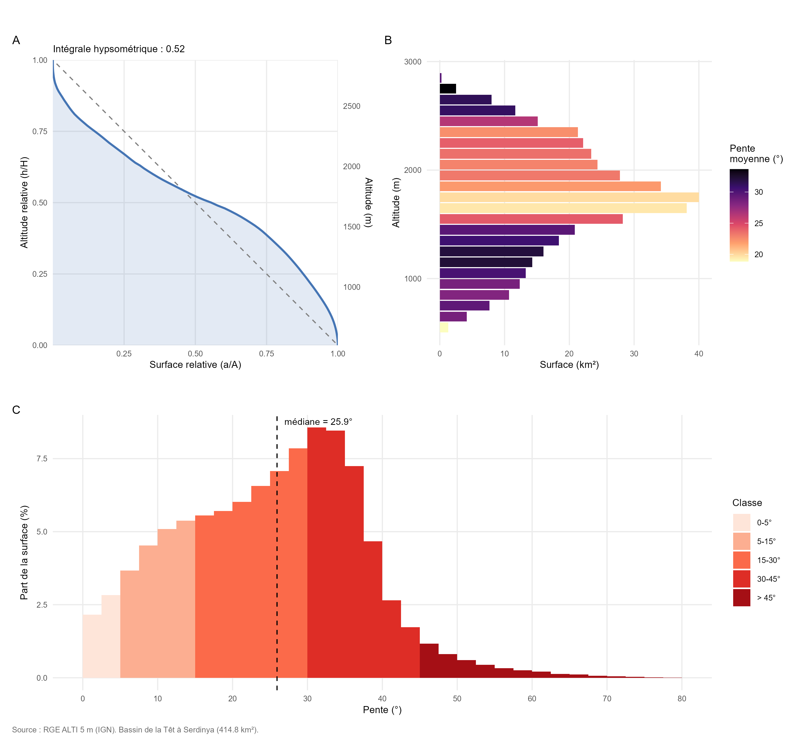
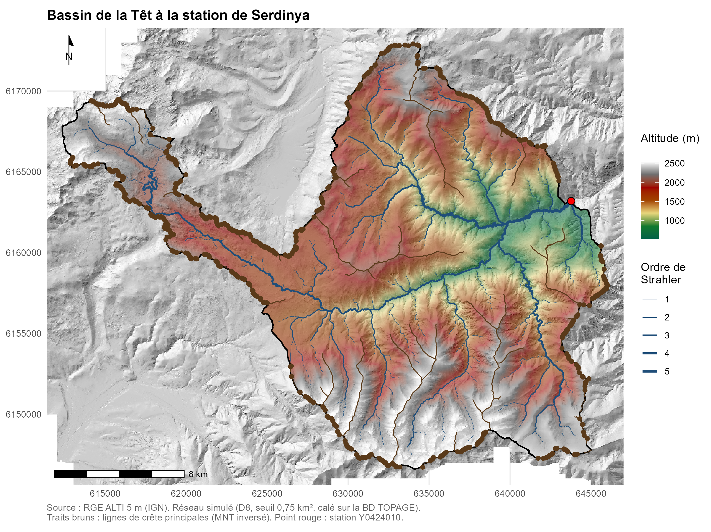
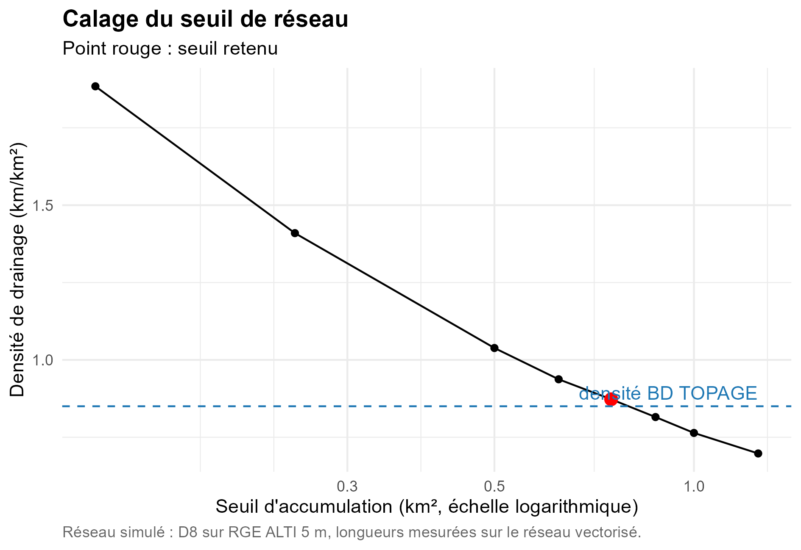
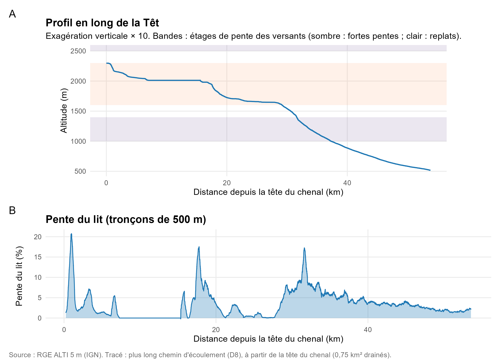

# bv_tet

<!-- badges: start -->
<!-- badges: end -->

# Analyse hydrologique réalisée dans le cadre du cours "Hydrosystèmes de Montagne" du M1 GAED, parcours GEOÏDES

Analyse de la forme, de l'hypsométrie et des pentes du bassin versant
de la Têt (Pyrénées-Orientales), sur le troncon dont l'exutoire est situé à Serdinya. Projet réalisé avec R (terra, sf, whitebox) et SAGA GIS.
Conception de la chaîne de traitement et analyse des résultats par Gaël Letourneur, scripts écrits avec l'IA Claude Code.
## Données utilisées

- **RGE ALTI 1 m, département 66** (IGN, Licence Ouverte Etalab 2.0).
- **BD TOPO, réseau hydrographique** (IGN).
- **BD TOPAGE, bassins versants topographiques** (Sandre / OFB / IGN).
- **BD TOPAGE, tronçons hydrographiques** (Sandre / OFB / IGN) : couche
  `sa:TronconHydrographique_FXX_Topage2024` du flux WFS
  `https://services.sandre.eaufrance.fr/geo/topage2024?`, extraite par
  intersection avec le bassin, placé dans `data/reference/troncons_topage.gpkg`.

L'exutoire, placé manuellement, est fourni dans `data/digitalisation/`.

## Exécution

Les paramètres communs (résolution, seuil du réseau) sont définis dans
`scripts/00_parametres.R`. 

| Script | Rôle |
|---|---|
| `00_parametres.R` | Paramètres communs à la chaîne |
| `01_import_mnt.R` | Mosaïque du RGE ALTI, découpage sur l'enveloppe BD TOPAGE, agrégation à 5 m |
| `02_correction_cuvettes.R` | Correction des dépressions du MNT par brèches |
| `03_ecoulement.R` | Direction d'écoulement (D8) et accumulation |
| `04_bassin.R` | Accrochage de l'exutoire à la station, délimitation du bassin |
| `05_validation.R` | Comparaison avec la station et la BD TOPAGE |
| `06_morphometrie.R` | Forme, relief, hypsométrie et pentes |
| `07_profil_long.R` | Profil en long de la Têt et pente du lit |
| `08_carte.R` | Carte du bassin et du réseau hydrographique simulé |
| `09_calage_reseau.R` | Calage du seuil du réseau sur la BD TOPAGE (hors chaîne) |
| `10_comparaison_saga.R` | Création d'un raster avec un pixel correspondant à l'exutoire, pour SAGA |
| `11_comparaison_methodes.R` | Comparaison de toutes les méthodes de délimitation du BV |

Le script 09 sert à choisir le seuil inscrit dans `00_parametres.R`.

## Résultats

### Délimitation du bassin

Le bassin est délimité à partir du RGE ALTI (1m agrégé à 5 m), après correction
des cuvettes, avec l'algorithme d'écoulement D8. L'exutoire est placé à la station hydrométrique
**Y0424010 (La Têt à Serdinya [Joncet])**, disponible sur HydroPortail), puis accroché au chenal simulé.
Une vérification a été réalisée grâce au logiciel SIG SAGA pour contrôler les délimitations du bassin.
Les deux délimitations ne diffèrent que de 659 pixels (0,016 km², soit 0,004 % de la surface.

| Contrôle | Résultat |
|---|---|
| Surface calculée via WhiteboxTools | 414,79 km² |
| Surface calculée via SAGA GIS | 414,78 km² |
| Surface de référence de la station | 424 km² (écart de −2,2 %) |
| Distance d'accrochage de l'exutoire | 27 m |
| Surface du bassin hors enveloppe BD TOPAGE | 2,0 km² |

Le bassin calculé suit les limites de la BD TOPAGE le long des crêtes,
y compris dans le couloir étroit de la haute Têt, entre le Capcir (Aude)
et la Cerdagne (El Segre). Les écarts correspondent à la partie aval de la
zone BD TOPAGE de Serdinya, située après l'exutoire, et à un petit secteur
au sud-ouest du lobe des sources (replat probable vers Mont-Louis).

### Morphométrie

**Choix du MNT :** le bassin est délimité sur le MNT corrigé, mais toutes
les mesures d'altitude et de pente portent sur le MNT d'origine.

*A : courbe hypsométrique. B : surface et pente moyenne par tranche
d'altitude de 100 m. C : distribution des pentes.*

| Indicateur | Valeur |
|---|---|
| Périmètre (contour lissé) | 144,5 km |
| Coefficient de Gravelius (contour lissé) | 2,00 |
| Longueur (plus long chemin d'écoulement) | 57,0 km |
| Rapport d'allongement de Schumm | 0,40 |
| Altitudes min / max | 516 m / 2 881 m |
| Altitudes moyenne / médiane | 1 743 m / 1 752 m |
| Dénivelé | 2 364 m |
| Intégrale hypsométrique | 0,52 |
| Pentes moyenne / médiane | 25,1° / 25,9° |

| Classe de pente | Part de la surface |
|---|---|
| 0–5° | 5,0 % |
| 5–15° | 18,5 % |
| 15–30° | 38,9 % |
| 30–45° | 33,3 % |
| > 45° | 4,3 % |

### Interprétation

- **Un bassin très allongé.** Le coefficient de Gravelius (2,0) et le
  rapport d'allongement (0,40) traduisent la forme du bassin : un grand
  lobe compact, prolongé par le long couloir de la haute Têt jusqu'au
  secteur des sources.
- **Trois étages de relief.** Les pentes sont fortes entre 1 000 et
  1 400 m (gorges de la Têt), douces entre 1 600 et 2 300 m (replats
  de la haute vallée), puis de nouveau
  fortes au-dessus de 2 500 m (parois et crêtes). La bande des replats
  concentre une grande part de la surface, ce qui explique la forme
  en S de la courbe hypsométrique.
- **Un bassin raide.** Plus d'un tiers de la surface (37,6 %) dépasse
  30°. La distribution des pentes chute nettement au-delà de 37°,
  ce qui évoque des pentes seuils, au-delà desquelles les versants
  meubles deviennent instables.

### Carte du bassin

Le réseau hydrographique est extrait de l'accumulation des écoulements,
puis hiérarchisé selon l'ordre de Strahler. La Têt atteint l'ordre 5
à l'exutoire.

**Choix du seuil.** Un pixel appartient au réseau s'il draine plus de
0,75 km². Ce seuil a été déterminé à partir de la densité de drainage des tronçons
BD TOPAGE, en excluant les écoulements artificiels. La densité du réseau
simulé (0,87 km/km²) s'écarte de 2,7 % de celle de la référence
(0,85 km/km²). 

**Lignes de crête.** Les lignes de crête sont extraites par inversion du
MNT. Le relief inversé est
ensuite traité de la même manière que pour déterminer le réseau hydrographique : 
correction des cuvettes par brèches, direction d'écoulement D8, accumulation, 
puis extraction avec le même seuil
(0,75 km²). Cela donne ainsi
les lignes de crête du relief réel, hiérarchisées selon l'ordre de
Strahler. Seules les crêtes d'ordre 2 ou plus sont représentées, pour la
lisibilité de la carte.

Les crêtes extraites se raccordent au contour du bassin et croisent ainsi la ligne de partage des eaux.

Pour un seuil compris 0,625 et 1 km², la densité reste à
±10 % de la référence. 

### Profil en long de la Têt

*A : profil en long, avec une exagération verticale de 10. Les bandes
rappellent les étages de pente des versants. B : pente du lit, calculée
sur des tronçons de 500 m.*

Le profil suit le plus long chemin d'écoulement, à partir de la tête du
chenal.

- **L'amont est en escalier.** On constate une succesion de paliers et de ressauts. Le premier correspond en
  partie à la surface du lac des Bouillouses. Les deux paliers se situent
  dans l'étage des replats mis en évidence par la morphométrie.
- **Puis une rupture de pente nette marque l'entrée dans les gorges**, à la
  sortie de l'étage des replats : la pente du lit y remonte à environ 15 %. 
  Une morphogénèse plausible serait celle d'une gorge de raccordement sous-glaciaire associé à l'ancien glacier de la Têt, et dont l'érosion continue aujourd'hui.
- **L'aval est concave et régulier**, avec une pente qui décroît jusqu'à
  2-3 % à l'exutoire. Cette partie du réseau est plus stable et matûre.

La succession de paliers et de ressauts évoque une morphogénèse de type glaciaire avec une sucession
de verrous et d'ombilics et une gorge de raccordement sous-glaciaire. Quant à la partie aval, elle présente un profil de type fluvial. La trajectoire de cette partie du Têt 
semble être le résultat de plusieurs dynamiques en interractions: la mise en place d'un réseau hydrographique post-glaciation, qui tend aujourd'hui vers un stade d'équilibre (comme le montre la partie la plus fluviale du profil). 

Cela n'empêche guère la Têt d'être le théâtre d'importants épisodes de crue, lié aux épisodes cévenols et à la débacle nivale au printemps. 
La présence d'écoulements artificialisés témoignent aussi de l'anthropisation du bassin-versant et des différents aménagements produits pour exploiter la ressource et limiter la vulnérabilité des installations humaines.
L'aval de la Têt est en effet à fort enjeu, du fait de la présence de Perpignan, métropole de 300 000 habitants, et de hauts-lieux touristiques (St-Cyprien, Canet-en-Roussilon etc).

### Limites

- Le périmètre dépend de la résolution : le contour brut, en marches
  d'escalier (forme carrée des pixels), est 19 % plus long que le contour lissé. Le coefficient
  de Gravelius est donc donné pour le contour lissé (tolérance de 5 m).
- L'agrégation à 5 m par la moyenne arrondit légèrement les sommets,
  et l'altitude maximale peut être légèrement sous-estimée.
- Le rapport de Melton  est de 0,12. Ce dernier reste, en l'état, difficilement interprétable.
  Ses seuils ont été établis pour de petits BV torrentiels, et semblent difficilement applicable à un bassin de 415 km². 
  Dans notre cas, ce n'est pas parce que le bassin est grand que ce dernier ne peut pas présenter une partie
  avec un fonctionnement en lave torentielle. C'est notamment le cas pour le premier troncon, au niveau des sources de la Têt.
- Le seuil du réseau reproduit la densité du réseau **cartographié** par
  la BD TOPAGE, qui omet souvent les ravines éphémères de tête. Les têtes
  de chenal réelles peuvent se situer plus haut, et le réseau réel être
  plus dense. L'ordre de Strahler maximal dépend directement de ce seuil.
  - La méthode identifie les crêtes au sens topographique (lignes le long
  desquelles le terrain descend des deux côtés). Elle ne distingue pas les
  arêtes rocheuses vives des croupes arrondies. Sur les replats, où le
  terrain est presque plat, la position des crêtes est moins bien définie.

## Packages

terra, sf, whitebox, ggplot2

